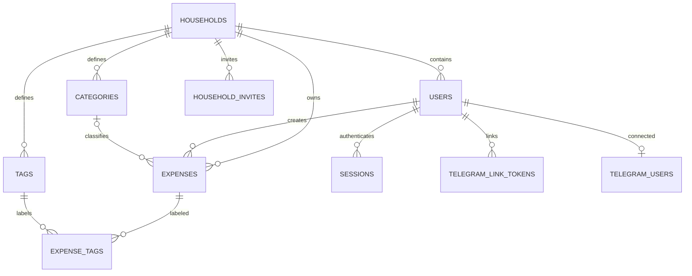

# Database schema (PostgreSQL)

[🇮🇹 Italiano](SCHEMA.md) · 🇬🇧 English

Versioned migrations are in `backend/migrations/versions/`; relationships are defined in `backend/app/models.py`.

| Table | Main data |
|---|---|
| `households` | The household that owns the data |
| `users` | Unique email, Argon2 hash, household, MFA state and hashed recovery codes |
| `sessions` | Hash of the opaque cookie, expiry, random CSRF token, and device metadata (public id, user agent, method, last seen) |
| `categories`, `tags` | Per-household vocabulary; categories carry an optional monthly budget |
| `expenses` | Decimal amount, currency, date, merchant, description, JSON line items, personal/shared visibility and document reference |
| `expense_tags` | Many-to-many link between expenses and tags |
| `household_invites` | Single-use invite hash with expiry |
| `telegram_link_tokens`, `telegram_users` | Single-use link token and Telegram account association; the latter also stores language and notification preferences |
| `budget_alerts_sent` | Deduplication of Telegram budget alerts (per category, month and level) |
| `passkey_credentials` | WebAuthn public keys registered by users |
| `exchange_rates` | Per-household currency rates (EUR per 1 unit) |

Files are not stored in PostgreSQL: `document_key` points to a random name in the `documents` volume. Exports and reports read data via SQL and respect household, selected currency and personal/shared visibility.
