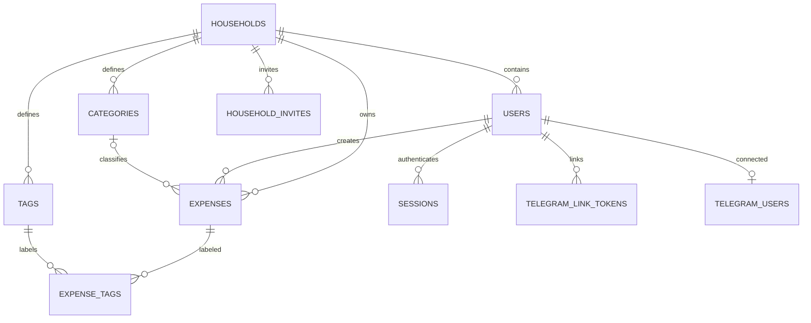

# Schema PostgreSQL

Le migrazioni versionate sono in `backend/migrations/versions/`; le relazioni sono definite in `backend/app/models.py`.

| Tabella | Dati principali |
|---|---|
| `households` | Nucleo familiare proprietario dei dati |
| `users` | Email unica, hash Argon2, household, stato MFA e codici di recupero hashati |
| `sessions` | Hash del cookie opaco, scadenza e token CSRF casuale associato alla sessione |
| `categories`, `tags` | Vocabolario separato per household |
| `expenses` | Importo decimale, valuta, data, esercente, descrizione, articoli JSON, visibilità personale/condivisa e riferimento al documento |
| `expense_tags` | Relazione molti-a-molti tra spese e tag |
| `household_invites` | Hash di invito monouso con scadenza |
| `telegram_link_tokens`, `telegram_users` | Collegamento monouso e associazione account Telegram |

I file non sono memorizzati in PostgreSQL: `document_key` punta a un nome casuale nel volume `documents`. Gli export/report leggono i dati via SQL e rispettano household, valuta selezionata e visibilità personale/condivisa.
